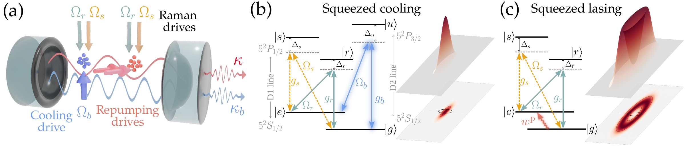

[](https://doi.org/10.5281/zenodo.24473853)

# Squeezed Cooling and Lasing: code and data

This repository contains the code and data required to reproduce the figures of the paper [Squeezed Cooling and Lasing with Cold Atoms in Cavity-QED](https://arxiv.org/abs/2611.24743) (arXiv:2611.24743). The code and data are archived on Zenodo: [doi:10.5281/zenodo.24473853](https://doi.org/10.5281/zenodo.24473853).

The simulations are Julia notebooks (cumulant expansions with [QuantumCumulants.jl](https://github.com/qojulia/QuantumCumulants.jl), exact steady states with [QuantumToolbox.jl](https://github.com/qutip/QuantumToolbox.jl)) and the figures are drawn with Python (matplotlib).

<p align="center">
  
</p>
<p align="justify">
  <b>Fig. 1: Implementation of the squeezed laser</b>. (a) Scheme of the proposed physical setup of the system. The two ensembles of rubidium atoms are trapped within an optical cavity and transversely pumped by external lasers. The blue colored ensemble contains atoms from panel (b), and the red one contains atoms from panel (c). (b) Energy level diagram of the cooling atoms. In the long-time limit, these act as a buffer, cooling the cavity to a squeezed vacuum state, represented with its Wigner function. (c) Energy level diagram of the lasing atoms that constitute the gain medium. When these are pumped with the repumping drives, the steady state can be accurately described by a phase-diffused mixture of displaced squeezed states. The black circle in both plots of the Wigner functions represents vacuum fluctuations.
</p>

## How to use

Clone the repository (`git clone`) or download the archived version from [Zenodo](https://doi.org/10.5281/zenodo.24473853).

**Julia** (1.11). The environment is pinned in `Project.toml` / `Manifest.toml`. From the repository root:

```bash
julia --project=. -e 'using Pkg; Pkg.instantiate()'
```

Run the notebooks with this environment and several threads, e.g. register a Jupyter kernel (requires [IJulia](https://github.com/JuliaLang/IJulia.jl)):

```bash
julia -e 'using IJulia; installkernel("Julia (squeezed laser)", "--project=$(pwd())", "--threads=auto")'
```

**Python** (3.11). The packages used by the plotting notebooks are pinned in `requirements.txt`:

```bash
pip install -r requirements.txt
```

The folders of Figs. 2–4 and S5 have the same layout:

* `notebooks/`: Julia simulations, numbered in the order they should be run; they write to `data/`.
* `data/`: the arrays used for the figure (`.npy`).
* `plot_figX.ipynb`: draws the panels from `data/` into `figures/` (panel (b) of Fig. 2, the Wigner functions, is drawn directly by a Julia notebook).
* `figures/`: the panels and the final figure (assembled in Inkscape).
* `README.md`: which notebook produces each panel, and the content of every data file.

The saved data are included, so the figures can be redrawn without running the simulations. All notebooks use paths relative to their own folder.

## Contents

| Folder | Figure |
|---|---|
| `fig1_scheme/` | Fig. 1: scheme of the system and level schemes for squeezed cooling and squeezed lasing (drawing only: `fig1.svg`, `fig1.pdf`). |
| `fig2_cooling/` | Fig. 2: squeezing of the cavity field by the cooling atoms: quadrature fluctuations, Wigner functions and squeezing spectrum. |
| `fig3_lasing/` | Fig. 3: phases of the squeezed laser as a function of pump rate and atom numbers: photon number, rates, linewidth and squeezing. |
| `fig4_spectra/` | Fig. 4: squeezing and emission spectra as a function of pump rate and cavity decay. |
| `figS5_seed/` | Fig. S5: squeezing spectrum of the laser with a coherent seed as a function of cavity decay. |

## Contact

Rodrigo Grande de Diego (rodrigo.grande@iff.csic.es)

## How to cite this code

If you use this code or data, please cite the paper ([arXiv:2611.24743](https://arxiv.org/abs/2611.24743)) and this repository:

```bibtex
@software{GrandeDeDiego2026code,
  author    = {Grande de Diego, Rodrigo and S{\'a}nchez Mu{\~n}oz, Carlos},
  title     = {Code and data for "Squeezed Cooling and Lasing with Cold Atoms in Cavity-QED"},
  year      = {2026},
  publisher = {Zenodo},
  doi       = {10.5281/zenodo.24473853},
  url       = {https://doi.org/10.5281/zenodo.24473853}
}
```
