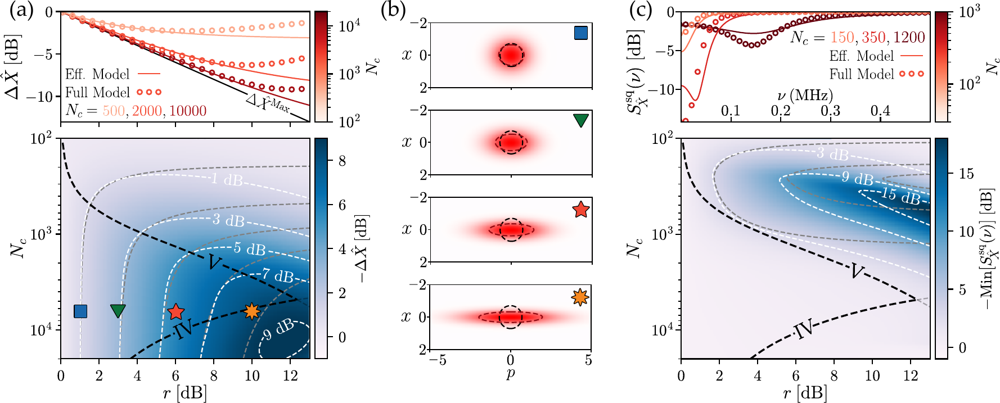

# Squeezed laser — code and data

Code and data to reproduce the figures of

> **[Title — to be added]**
> Rodrigo Grande de Diego and Carlos Sánchez Muñoz
> **[arXiv number — to be added]**

The simulations are Julia notebooks (cumulant expansions with [QuantumCumulants.jl](https://github.com/qojulia/QuantumCumulants.jl), exact steady states with [QuantumToolbox.jl](https://github.com/qutip/QuantumToolbox.jl)); the figures are drawn with Python (matplotlib).

<p align="center">
  <br>
  <em>Fig. 2 — Squeezing of the cavity field by the cooling atoms. (a) Quadrature fluctuations ΔX̂ as a function of the squeezing parameter r and the number of cooling atoms N<sub>c</sub>. (b) Wigner functions of the cavity field at the points marked in (a). (c) Minimum of the squeezing spectrum S<sup>sq</sup><sub>X̂</sub>(ν), with the spectrum for three values of N<sub>c</sub> on top.</em>
</p>

## How to use

**Julia** (1.11). The environment is pinned in `Project.toml` / `Manifest.toml`. From the repository root:

```bash
julia --project=. -e 'using Pkg; Pkg.instantiate()'
```

Run the notebooks with this environment and several threads, e.g. register a Jupyter kernel (requires [IJulia](https://github.com/JuliaLang/IJulia.jl)):

```bash
julia -e 'using IJulia; installkernel("Julia (squeezed laser)", "--project=$(pwd())", "--threads=auto")'
```

**Python** (3.11) with `numpy`, `scipy`, `matplotlib` and `jupyter`.

Each figure folder has the same layout:

* `notebooks/` — Julia simulations, numbered in the order they should be run; they write to `data/`.
* `data/` — the arrays used for the figure (`.npy`).
* `plot_figX.ipynb` — draws the panels from `data/` into `figures/`.
* `figures/` — the panels and the final figure (assembled in Inkscape).
* `README.md` — which notebook produces each panel, and the content of every data file.

The saved data are included, so the figures can be redrawn without running the simulations.

## Contents

| Folder | Figure |
|---|---|
| `fig2_cooling/` | Fig. 2 — squeezing of the cavity field by the cooling atoms: quadrature fluctuations, Wigner functions and squeezing spectrum. |
| `fig3_lasing/` | Fig. 3 — phases of the squeezed laser as a function of pump rate and atom numbers: photon number, rates, linewidth and squeezing. |
| `fig4_spectra/` | Fig. 4 — squeezing and emission spectra as a function of pump rate and cavity decay. |
| `figS5_seed/` | Fig. S5 — squeezing spectrum of the laser with a coherent seed as a function of cavity decay. |

## Contact

Rodrigo Grande de Diego — rodrigo.grande@iff.csic.es

## How to cite

If you use this code, please cite:

```bibtex
@article{TO_BE_ADDED,
  title   = {[Title — to be added]},
  author  = {Grande de Diego, Rodrigo and S{\'a}nchez Mu{\~n}oz, Carlos},
  journal = {arXiv preprint [arXiv number — to be added]},
  year    = {[Year — to be added]}
}
```
